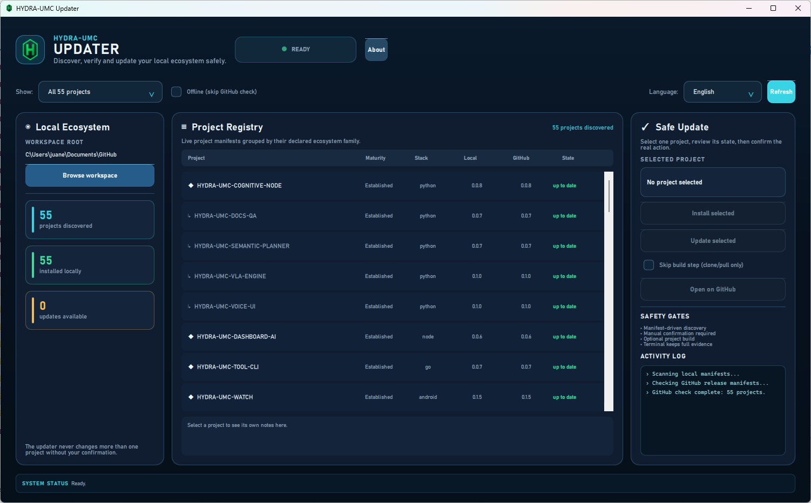
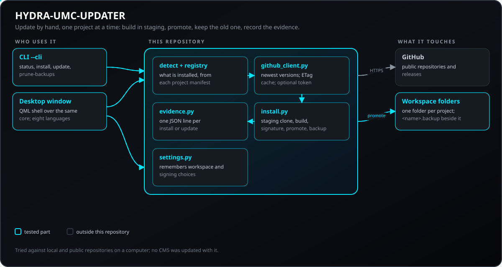
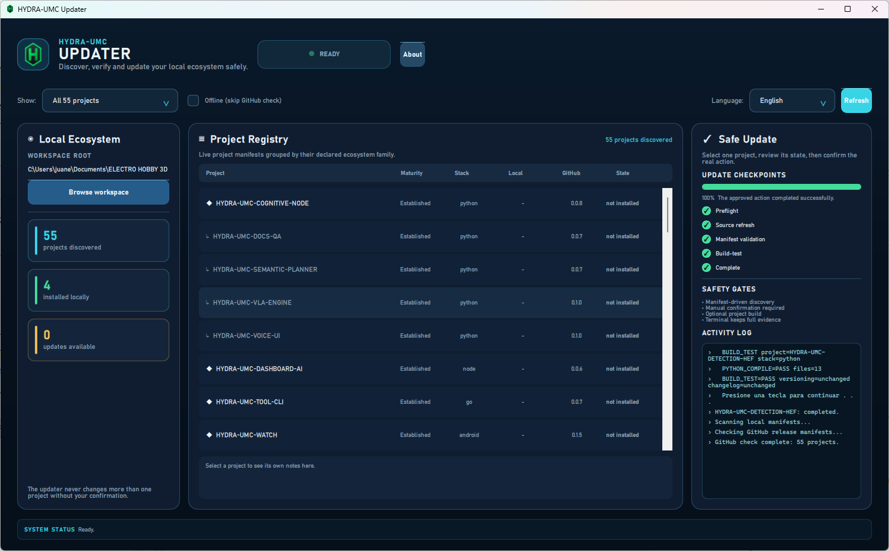
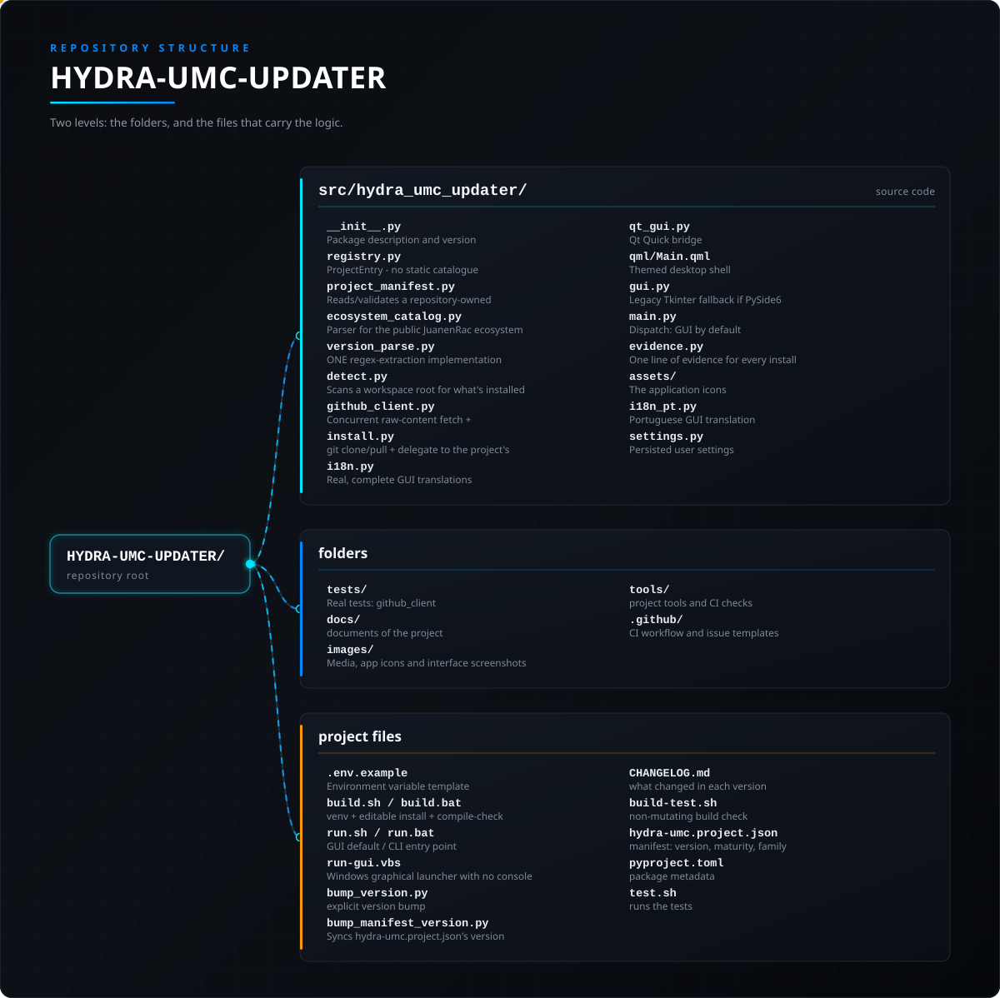

<!-- =============================================================================
HYDRA-UMC-UPDATER - Installs and updates the HYDRA-UMC projects
Copyright (C) JuanenRac (Electro Hobby 3D) <electrohobby3d@gmail.com>
GPL-3.0-or-later - see LICENSE
============================================================================= -->

<p align="center">
  
</p>

# 📦 HYDRA-UMC-UPDATER

<p align="center"><a href="README.md">🇺🇸 English</a> | <a href="README_spa.md">🇪🇸 Español</a> | <a href="README_fra.md">🇫🇷 Français</a> | <a href="README_ita.md">🇮🇹 Italiano</a> | 🇩🇪 <b>Deutsch</b> | <a href="README_zho.md">🇨🇳 简体中文</a> | <a href="README_jpn.md">🇯🇵 日本語</a> | <a href="README_por.md">🇵🇹 Português</a></p>

### 📦 Erkennt, installiert und aktualisiert das gesamte HYDRA-UMC-Ökosystem von Hand

<p align="center">
  
  
  
  
  
  
  
</p>

---

> **Stand von Sicherheit (Safety) und Security:** Dieses Ökosystem ist kein zertifiziertes Sicherheitssystem. Es gibt noch keinen Hardware-E-STOP-Pfad, keine von der Firmware durchgesetzten Grenzen oder Verriegelungen und keinen verifizierten Bewegungsbefehl; Firmware-Images werden mit CRC-32 und einer Ed25519-Signatur geprüft, und ein Release-Build verweigert die veröffentlichten Entwicklungsschlüssel (die Werkzeugköpfe und Erweiterungsplatinen hinter dem Relais laufen noch mit URTC-Bootloadern, die statt einer Signatur ein HMAC-SHA256 mit gemeinsamem Schlüssel verwenden); TLS und gegenseitiges TLS sind optional und standardmäßig aus; noch keine eigene Platine wurde bestückt oder getestet. Lesen Sie die [Sicherheitsbasis](https://github.com/JuanenRac/HYDRA-UMC-DOCS/blob/main/docs/SECURITY_BASELINE.md) und das [Bedrohungsmodell](https://github.com/JuanenRac/HYDRA-UMC-DOCS/blob/main/docs/THREAT_MODEL.md), bevor Sie sich für die Sicherheit einer Person auf eine Aussage hier verlassen.

---

## 📋 Auf einen Blick

| | |
|---|---|
| Version | `0.5.0` |
| Reifegrad | Etabliert |
| Tests | 163 (`python -m pytest -q tests`) |
| Technik | Python 3.10+ / PySide6 / Qt Quick (QML) / Tkinter (legacy fallback) / Git / GitHub raw content |
| Ziel | Der PC der Person, die es benutzt |
| Auf echter Hardware | Nicht zutreffend: nichts hiervon läuft auf Hardware |

**Springe zu:** [Überblick](#-überblick) · [Architektur](#-architektur) · [Sicherheit und Schutz](#-sicherheit-und-schutz) · [Konfiguration](#-konfiguration) · [Schnellstart](#-schnellstart) · [Tests](#-tests) · [Fehlerbehebung](#-fehlerbehebung) · [Struktur des Repositorys](#-struktur-des-repositorys) · [Verwandte Projekte](#-verwandte-projekte)

## 🚦 Projektstatus

Jede Zeile ist ein Teil dieses Repositorys, und die Ampel sagt, wie weit er heute ist. Sie beruht auf dem, was das Repository zeigen kann (Tests, Builds, Läufe), nicht auf dem, was geplant ist.

🟢 Fertig und überprüft · 🟡 Funktioniert, mit bekannten Grenzen · 🟠 Teilweise fertig oder noch nicht überprüft · 🔴 Nicht gemacht oder funktioniert nicht

| Bereich | Stand | Was das hier bedeutet |
|---|---|---|
| Software | 🟢 | Für seinen Zweck vollständig und stabil; die Ehrlichkeitsprüfung oben nennt die bekannten Grenzen |
| Tests | 🟢 | 163 automatische Tests, bei jeder Änderung ausgeführt |
| Echte Hardware | 🟢 | Nicht zutreffend: nichts hiervon läuft auf Hardware |
| Dokumentation | 🟢 | README in acht Sprachen, bei jeder Änderung gegen das Manifest geprüft |

## 🎯 Überblick

HYDRA-UMC-UPDATER ist ein kleines Tool - Fenster-GUI standardmäßig, volle
CLI mit `--cli` - das sowohl auf dem echten CM5 als auch auf dem eigenen
Windows/Linux/macOS-Rechner eines Entwicklers laufen soll (jeder
Workspace mit demselben Checkout-Layout) und drei Fragen für jedes
andere echte Projekt beantwortet, das es über das eigene
`hydra-umc.project.json`-Manifest jedes Nachbar-Checkouts entdeckt - die
Anzahl selbst ist hier nie fest codiert, da sie mit dem Ökosystem wächst:

1. **Was ist hier tatsächlich installiert, und in welcher Version?**
2. **Was ist die neueste auf GitHub veröffentlichte Version?**
3. **Falls GitHub neuer ist, lass mich ein Projekt oder eine bestätigte sequenzielle Sammelaktion wählen.**

Dieser letzte Punkt ist bewusst und nicht verhandelbar: Dieses Tool ändert
nie ein Projekt aus eigener Initiative. Eine Aktion für ein ausgewähltes
Projekt verlangt immer eine ausdrückliche Bestätigung. Die GUI kann auch
**Alle fehlenden installieren** oder **Alle veralteten aktualisieren**
anbieten; beides sind getrennt bestätigte, sequenzielle Sammelaktionen mit
denselben Manifest-, Versions- und Sicherheitsprüfungen. Es gibt kein
unbeaufsichtigtes nächtliches Auto-Update. Die Bestätigung zeigt die genauen Projekte der Sammelaktion in der Reihenfolge, in der sie laufen.

Auch gehört nicht jedes entdeckte Projekt auf die CM5 selbst - manche sind Werkzeuge, die ein Entwickler von seinem eigenen PC aus ausführt (Firmware wird VON einer Workstation kompiliert und geflasht, nicht AUF der Zelle gebaut), oder Apps, die auf einem Telefon/einer Uhr installiert werden. Das Manifest jedes Projekts hält fest, was zutrifft (siehe Abschnitt 3), und die Projekttabelle der GUI kann danach filtern - standardmäßig werden alle Projekte angezeigt, sodass weder der Updater selbst noch das SDK verborgen bleiben.

Illustratives Beispiel (die genaue Projektanzahl und jede Versionsnummer
unten sind für die Form der Ausgabe frei erfunden, kein echter erfasster
Lauf - die echte Anzahl ist immer das, was `registry.py` heute entdeckt,
niemals eine in diesem Dokument fest codierte Zahl):

```
$ hydra-umc-updater --cli status
Workspace root: /home/pi/HYDRA-UMC
PROJECT           MATURITY     ROLE      STACK       LOCAL     GITHUB    STATE
-----------------------------------------------------------------------------
HYDRA-UMC         functional   firmware  firmware-c  0.0.7     0.0.7     up to date
HYDRA-UMC-SERVER  functional   service   node        0.0.5     0.0.9     OUTDATED
HYDRA-UMC-STUDIO  functional   client    node        0.0.8     0.1.3     OUTDATED
...
59/59 installed, 2 outdated
Run `hydra-umc-updater update <project>` to update one by hand - never automatic, see this tool's own README.

$ hydra-umc-updater --cli update HYDRA-UMC-SERVER
Updating HYDRA-UMC-SERVER into /home/pi/HYDRA-UMC ...
OK  Updated /home/pi/HYDRA-UMC/HYDRA-UMC-SERVER to v0.0.9 (commit 1a2b3c4d5e6f) after a verified build; previous installation kept at /home/pi/HYDRA-UMC/HYDRA-UMC-SERVER.backup-9f3c2d1a
```

`hydra-umc-updater` ohne Argumente aufzurufen (oder per Doppelklick)
öffnet dieselbe Information in einem Fenster - eine Projekttabelle, ein
Filter nach Deployment-Ziel, und Installieren/Aktualisieren-Schaltflächen
für die ausgewählte Zeile.

<p align="center">
  
</p>

## 🧩 Rolle in HYDRA-UMC

**HYDRA-UMC-UPDATER** findet, installiert und aktualisiert die HYDRA-UMC-Projekte auf dem Rechner, auf dem er läuft, von Hand und einzeln. Eine neue Version wird zuerst in einem Staging-Ordner geklont und gebaut und erst dann an ihren Platz verschoben, die vorherige bleibt als Sicherung, und jeder Versuch hinterlässt eine Nachweiszeile. Er hat eine Kommandozeile und ein Desktop-Fenster, die denselben Kern aufrufen.

## 🏛️ Architektur

<p align="center">
  
</p>

### WIE EINE PRÜFUNG/AKTUALISIERUNG WIRKLICH FUNKTIONIERT

- **Versionsquelle**
  dieses Ökosystems (jeder echte Build erhöht eine Versionsnummer, die
  IN einer Quelldatei lebt - `pyproject.toml`, `Cargo.toml`,
  `version.go`, `package.json`, `version.properties`, `pubspec.yaml`
  oder ein Firmware-`#define`, je nach Stack des Projekts) hat nie einen
  Git-Tag oder ein GitHub-Release für diesen Sprung erzeugt. Dieses Tool
  liest daher DIESELBE Datei, die das eigene `bump_version.py`/
  Build-Skript jedes Projekts bereits schreibt, direkt vom
  Standard-Branch des Repos über GitHubs Raw-Content-Host - nicht die
  Releases-API, die melden würde, dass alle Projekte keinerlei Releases
  haben.
- **Lokale Erkennung**: Für jedes entdeckte Projekt wird
  geprüft, ob ein Verzeichnis mit genau diesem Namen unter der
  Workspace-Wurzel existiert (das Standard-Layout des Ökosystems - jedes
  Projekt als Geschwisterverzeichnis, genau das, was build-frontend.sh/
  HYDRA-UMC-SUITEs eigene Discovery bereits voraussetzen), und falls ja,
  wird dessen eigene lokale Kopie derselben Versionsdatei gelesen.
- **Eine einzige Parsing-Implementierung** (`version_parse.py`) wird
  zwischen dem lokalen Lesen und dem GitHub-Abruf geteilt, sodass ein
  lokaler Checkout und ein GitHub-Abruf niemals von zwei unabhängig
  auseinanderdriftenden Regexes interpretiert werden.
- **Installieren/Aktualisieren**: `git clone` (Installation) baut
  danach als separaten Schritt. Das Aktualisieren eines BEREITS
  BESTEHENDEN Checkouts ist stattdessen atomar-durch-Verifikation: der
  Kandidat wird geklont, per Fast-Forward gemergt (nie ein erzwungener
  Reset, sodass echte lokale Änderungen laut fehlschlagen statt verworfen
  zu werden) und ZUERST in einem vollständig unabhängigen Staging-Klon
  gebaut/verifiziert - die laufende Installation wird nur (über zwei
  aufeinanderfolgende Verzeichnis-Umbenennungen, die vorherige
  Installation bleibt unter `<name>.backup-xxxxxxxx` erhalten, statt gelöscht zu
  werden) angefasst, wenn dieser Staging-Build tatsächlich erfolgreich
  ist. Ein Build-Fehler, ein divergierender/schmutziger Checkout, ein
  Absturz oder eine volle Festplatte an jedem Punkt vor dieser
  endgültigen Beförderung lassen die vorherige Installation vollständig
  unangetastet und weiterhin betriebsbereit - siehe den eigenen
  Docstring von `clone_or_pull` in `install.py`. Das eigene Git-Remote
  des Staging-Klons wird gleich nach dessen Erstellung auf das echte
  GitHub-Upstream zurückgesetzt (ein einfacher lokaler Klon würde
  andernfalls weiterhin auf den alten Installationspfad zeigen und nach
  der Beförderung still alle künftigen Updates beenden), und die echten
  lokalen Daten des installierten Checkouts (alles, was Git als
  unversioniert oder ignoriert betrachtet - `data/settings.json` und
  Ähnliches, ohne regenerierbare Build-Artefakte) werden vor dem Bauen
  in den Staging-Klon übernommen, sodass der echte Betriebszustand eines
  Projekts ein Update übersteht, statt im aufbewahrten `.backup`-
  Checkout gestrandet zu bleiben. So oder so wird das
  eigene `build-test.sh`/`build-test.bat` dieses Projekts (die nicht-
  versionierende Prüfung - siehe Abschnitt 3) ausgeführt, falls
  vorhanden. Dieses Tool reimplementiert nie die eigenen Build-Schritte
  eines Projekts.

- **Optionale Signaturprüfung**: Das `build-test`-Skript eines Kandidaten ist Code, den der Kandidat selbst mitbringt und der hier ausgeführt wird, bevor irgendetwas bewiesen hat, dass der Commit vom Maintainer stammt. Mit `HYDRA_UMC_UPDATER_REQUIRE_SIGNED=1` führt der Updater zuerst `git verify-commit` auf dem akzeptierten Kandidaten im Staging-Klon aus und bricht dort ab, wenn der Commit keine Signatur hat, der dieser Rechner vertraut (ein gpg-Schlüssel im Schlüsselbund oder ein ssh-Signierer in `gpg.ssh.allowedSignersFile`): Es wird nichts gebaut oder ausgeführt, und die laufende Installation bleibt unberührt. Standardmäßig aus, weil dafür ein Schlüsselbund auf dem Rechner nötig ist, der dem Schlüssel des Maintainers vertraut.

- **Eine frische `.venv` nach jeder Übernahme**: Hatte die ersetzte Installation eine `.venv`, bekommt die übernommene Kopie eine neue (`python -m venv`, danach `pip install -r requirements.txt`, wenn das Projekt diese Datei hat) statt keiner; die alte bleibt im `.backup`. Abschalten mit `HYDRA_UMC_UPDATER_RECREATE_VENV=0` oder der gespeicherten Einstellung `recreate_venv`. Lässt sie sich nicht erstellen, wird die Aktualisierung als fehlgeschlagen gemeldet und das Backup genannt, das die alte noch enthält.
- **Weitere Sicherheitsnetze**: pro Arbeitsbereich nur eine Installation oder Aktualisierung gleichzeitig (Sperrdatei); ein Zeitlimit für jeden git-Befehl und jeden Build-Test, ohne je nach Zugangsdaten zu fragen; ein unerwarteter Fehler wird zu einem fehlgeschlagenen Ergebnis im Fenster und in der Nachweisdatei, nie zu einem auf "arbeitet" hängenden Fenster; die Signaturprüfung gilt auch für eine Erstinstallation und lässt sich in den gespeicherten Einstellungen einschalten (`require_signed_commits`; eine unlesbare Einstellungsdatei zählt als eingeschaltet), solange sie aus ist, zeigt das Fenster einen roten Hinweis; ein lokaler Commit, der ein Fast-Forward verhindert, wird in der Ablehnung genannt; eine neue Installation mit fehlgeschlagenem Build wird wieder entfernt; veraltete Staging-Ordner werden zu Beginn eines Laufs aufgeräumt, und `--cli prune-backups [--keep N] [--dry-run]` entfernt alte Ordner `<name>.backup-xxxxxxxx` nur auf Anforderung.

<p align="center">
  
</p>

### ARCHITEKTUR UND DESIGN-ENTSCHEIDUNGEN

- **Qt-Quick-GUI standardmäßig, `--cli` für Headless.** `main.py` prüft
  `--cli`, bevor die optionale PySide6-Laufzeit importiert wird. Die CLI
  funktioniert auf einer CM5 ohne Display und Desktop-Abhängigkeit; ohne
  Argumente startet QML, sofern verfügbar, und Tkinter bleibt nur Fallback.
- **Die Fenster-GUI ist echt und mehrsprachig in 8 Sprachen (`i18n.py`) - `--cli` ist es absichtlich nicht.** Jedes echte Widget benennt sich live aus einer Sprach-`Combobox` neu (en/es/fr/it/de/zh/ja/pt, dieselben 8, die das öffentliche Dashboard und jede README ausliefern), erkannt aus einer gespeicherten Präferenz oder dem eigenen Locale des Betriebssystems. Projekt-/Familiennamen sowie der echte `notes`/`tech`-Text jedes Projekts bleiben unübersetzt - `registry.py` ist ihre einzige Quelle der Wahrheit, und 8 parallele Kopien echter Engineering-Dokumentation würden genau das verhindern. Die `--cli`-Ausgabe bleibt absichtlich nur auf Englisch: Sie ist zum Skripten/Weiterleiten gedacht, wo stabiler, grep-barer Text mehr zählt als Lokalisierung.
- **`deploy` ist eine Klassifizierung, keine Einschränkung.** Jedes
  entdeckte Projekt als "ein Ding, das auf den CM5 gehört" zu behandeln, war falsch
  - Firmware-Repos werden VON einem PC kompiliert und geflasht (der CM5
  braucht nur die resultierende Binärdatei über CAN-OTA, nie den
  eigenen Quellcode dieses Repos), und mehrere Werkzeuge (URTC-FLASHER,
  HYDRA-UMC-SUITE, HYDRA-UMC-TOOL-CLI, ...) sollen auf dem eigenen
  Arbeitsplatz eines Bedieners laufen, nicht innerhalb der Zelle selbst.
  Das `deploy`-Feld von `registry.py` ("cm5" / "user-pc" / "mobile" /
  "wearable" / "dev-server") verzeichnet das, und der GUI-Filter verwendet es als
  sinnvollen Ausgangspunkt - nie als harte Einschränkung, da dieses
  selbe Tool auch auf dem eigenen PC eines Entwicklers laufen soll, wo
  jedes entdeckte Projekt gleichermaßen zulässig zu inspizieren ist.
- **Keine stack-spezifische Build-Logik in diesem Werkzeug.** Das Ökosystem umfasst 7 Toolchains (Python, Rust, Go, Node/TS, Android/Kotlin, Flutter, ARM-Firmware). `npm install && npm run build` / `cargo build --release` / `./gradlew assembleDebug` / usw. HIER nachzubauen würde einen zweiten Ort schaffen, der behauptet zu wissen, wie jedes Projekt gebaut wird, und garantiert von den echten (und bereits korrekten) Prüfungen des Projekts selbst abdriftet. `install.py` führt stattdessen nur das nicht versionierende `build-test.sh` des Projekts aus (`build-test.bat` unter Windows), das prüft, ohne eine Version zu erhöhen; ein Projekt ohne ein solches wird mit "No non-versioning build-test.sh/.bat found" abgelehnt.
- **GitHub-Rohinhalt, nicht die Releases-API.** Siehe Abschnitt 2 oben -
  die Versionierungskonvention dieses Ökosystems erzeugt nie ein
  Tag/Release, daher wäre die Releases-API hier aktiv falsch, nicht nur
  weniger bequem.
- **Ein vorübergehender Netzwerkfehler bekommt einen echten
  Wiederholungsversuch; eine definitive Antwort nie.** Jede echte
  GitHub-Anfrage (`_urlopen_with_retries` in `github_client.py`)
  wiederholt bis zu 3-mal mit Backoff, aber nur, wenn die Verbindung
  überhaupt keine Antwort erhalten hat (DNS/Timeout/Reset). Ein echter
  HTTP-Status, den GitHub tatsächlich zurückgegeben hat - 404, 403, 500 -
  wird nie wiederholt: GitHub hat bereits geantwortet, und ein erneuter
  Versuch würde nur mehr Rate-Limit für dasselbe Ergebnis verbrauchen.
- **Ein fehlerhafter entfernter Katalog schlägt laut fehl; ein
  fehlerhaftes Projekt nicht.** Wenn die GitHub-Repository-Liste selbst
  nicht erreichbar oder nicht parsbar ist, löst `discover_remote_projects()`
  eine Ausnahme aus - sowohl `gui.py` als auch `main.py` fangen sie
  bereits ab und fallen auf die lokal entdeckte Projektliste zurück,
  statt einen defekten oder leeren Scan anzuzeigen. Das fehlerhafte
  Manifest eines einzelnen Repositorys wird dagegen in die eigene
  `errors`-Liste dieses Scans isoliert und bricht die Entdeckung des
  restlichen Katalogs nie ab - ein echter Test mit Fixture-Server
  (`tests/test_github_client.py`) belegt beide Pfade.
- **Die CLI bleibt explizit; GUI-Sammelaktionen bleiben bestätigt.** Die
  CLI-Befehle `install`/`update` erwarten einen Projektnamen. Die GUI kann
  **Alle fehlenden installieren** oder **Alle veralteten aktualisieren**, aber
  nur nach separater Bestätigung und nacheinander durch dieselben
  Sicherheitsprüfungen. Es gibt kein unbeaufsichtigtes automatisches Update.
- **Nur Standardbibliothek.** `urllib` für die GitHub-Abrufe
  (`github_client.py`), `subprocess` für git-/Build-Skript-Aufrufe
  (`install.py`), sonst nichts - dass ein Tool, das für die
  Abhängigkeits-Gesundheit ALLER anderen Projekte verantwortlich ist,
  selbst ohne Abhängigkeiten bleibt, ist bewusst.
- **Bekannte Vereinfachung**: HYDRA-UMC und URTC sind echte
  Mehrkomponenten-Firmware-Repos (6 bzw. 4 unabhängig versionierte
  Binärdateien - siehe deren eigene `VERSION_CHECKLIST.txt`/
  `build_firmware.sh`) ohne eine einzige "die" Versionsnummer.
  `registry.py` verfolgt EINE repräsentative Komponente pro Repo - genug,
  um "ist dieses Repo ungefähr aktuell?" zu beantworten, kein Ersatz für
  `build_firmware.sh`s eigene `firmware_manifest.json` für ein echtes
  Flashen.

## 🔒 Sicherheit und Schutz

| Bedrohung | Abwehr | Wo |
|---|---|---|
| Eine neue Version, die nicht baut, hinterlässt ein halb aktualisiertes Projekt | Der Kandidat wird zuerst in einem eigenen Staging-Ordner geklont, zusammengeführt und gebaut; der installierte Ordner bleibt unberührt, bis das gelingt, dann verschieben zwei Umbenennungen ihn und behalten den alten als `<name>.backup` | `install.py` |
| Ein Update, das in Wahrheit ein Rückschritt ist oder lokale Arbeit verwirft | Das geholte Manifest wird validiert und eine niedrigere Version abgelehnt; es wird nur ein Fast-Forward-Merge benutzt, und eine verfolgte lokale Änderung stoppt das Update hörbar | `install.py`, `project_manifest.py` |
| Code aus einem Commit ausführen, der nicht vom Maintainer stammt | Mit `HYDRA_UMC_UPDATER_REQUIRE_SIGNED=1` (oder der gespeicherten Einstellung) muss der geklonte Commit `git verify-commit` bestehen, bevor irgendetwas davon ausgeführt wird; ein fehlendes Werkzeug, ein unsignierter Commit oder ein unbekannter Schlüssel zählen als nicht signiert | `install.py` |

**Was er nie tut:** sich selbst aktualisieren. Jede Installation und jedes Update ist ein Befehl, den jemand ausführt, und das `GITHUB_TOKEN`, das er lesen kann, ist optional und braucht nur Lesezugriff.

## ⚙️ Konfiguration

| Variable | Standard | Was sie festlegt |
|---|---|---|
| `GITHUB_TOKEN` | keiner | optionales Nur-Lese-Token; ohne eins erlaubt GitHub 60 Anfragen pro Stunde |
| `HYDRA_UMC_UPDATER_REQUIRE_SIGNED` | `0` | `1`, `true`, `yes` oder `on` verlangt eine gültige Signatur am geklonten Commit |
| `HYDRA_UMC_UPDATER_RECREATE_VENV` | an | `0` behält die alte virtuelle Umgebung, statt nach einer Übernahme eine neue anzulegen |
| `--workspace` | der übergeordnete Ordner dieses Ordners | Ordner mit einem Unterordner je Projekt |

## 🚀 Schnellstart

Benötigt Python 3.10 oder neuer.

```bash
./build.sh  # Linux, macOS (build.bat on Windows)
./run.sh --cli status --offline
./run.sh --cli status --workspace ~/hydra
./run.sh --cli install HYDRA-UMC-DATALAKE
./run.sh --cli update HYDRA-UMC-DATALAKE
./run.sh --cli prune-backups --keep 2 --dry-run
```

## 🧪 Tests

163 automatische Tests laufen mit `python -m pytest -q tests`. Sie brauchen weder Hardware noch etwas außerhalb dieses Rechners.

Die CI führt `HYDRA_UMC_CI=1 python tools/ci_validate.py` aus; das prüft das Manifest, die Dokumente, die acht READMEs und die Bilder.

## 🏗️ Build und Veröffentlichung

```bash
chmod +x build.sh   # einmalig
./build.sh          # erstellt .venv, pip install -e ., Compile-Check von allem
./run.sh                              # Fenster-GUI (standardmäßig)
./run.sh --cli status                 # was installiert ist, lokale vs. GitHub-Version
./run.sh --cli status --offline       # dasselbe, ohne GitHub-Prüfung
./run.sh --cli install <PROJEKT-NAME> # klont + baut ein noch nicht installiertes Projekt
./run.sh --cli update  <PROJEKT-NAME> # aktualisiert + baut ein bereits installiertes Projekt neu
./run.sh --cli prune-backups --keep 2  # entfernt alte Ordner <name>.backup-xxxxxxxx (behält die 2 neuesten je Projekt)
```

Unter Windows: `build.bat`, dann `run.bat` (GUI) / `run.bat --cli status`
/ `run.bat --cli install <Name>` / `run.bat --cli update <Name>`.

Die bevorzugte GUI braucht die optionale Qt-Laufzeit (`pip install -e ".[gui]"`;
`build.bat`/`build.sh` installieren sie bereits). `--cli` hat keine GUI-
Abhängigkeit und ist der richtige Einstieg für eine headless CM5. Ohne Qt
bleibt das alte Tkinter-Fenster nur ein Kompatibilitäts-Fallback.

**Fehlerbehebung**

- `status` zeigt `?` für die lokale oder GitHub-Version eines Projekts: Seine Versionsdatei existiert, aber der Eintrag `native_version` in dessen eigener `hydra-umc.project.json` stimmt nicht mehr damit überein, wo seine Version tatsächlich steht - korrigieren Sie das Manifest dieses Projekts.
- `status` zeigt `-` für GitHub ohne angezeigten Fehler: führen Sie
  `status` aus (ohne `--offline`) - `-` erscheint nur, wenn die
  GitHub-Prüfung komplett übersprungen wurde.
- `install`/`update` schlägt mit "No non-versioning build-test.sh/.bat found" fehl: Dieses Projekt hat noch kein `build-test.sh`/`build-test.bat` - fügen Sie ihm das Standardskript des Ökosystems hinzu (es muss prüfen, ohne eine Version zu erhöhen).
- `git merge --ff-only failed`: Der lokale Checkout hat eine abweichende Historie oder lokale Commits (die Meldung nennt sie) - verschieben oder verwerfen Sie sie (`git status`/`git log` im Verzeichnis dieses Projekts), bevor Sie `update` erneut versuchen. Nicht committete Änderungen an verfolgten Dateien werden gleich zu Beginn abgelehnt. Dieses Werkzeug setzt einen Checkout nie zwangsweise zurück.

## 🩺 Fehlerbehebung

| Du siehst | Weil | Tu |
|---|---|---|
| `unauthenticated requests are capped at 60/hour` | Das Limit von GitHub für Anfragen ohne Token wurde erreicht | Warten, `status --offline` benutzen oder ein Nur-Lese-`GITHUB_TOKEN` setzen |
| the update stops and names changed files | Eine verfolgte Datei des Projekts wurde auf diesem Rechner geändert | Die Änderung selbst committen, zurückstellen oder verwerfen und `update` erneut ausführen |

## 📂 Struktur des Repositorys

<p align="center">
  
</p>

<details>
<summary>Textversion des Baums</summary>

```text
HYDRA-UMC-UPDATER/
├── src/hydra_umc_updater/     Quellcode
│   ├── __init__.py            Paketbeschreibung und Version
│   ├── registry.py            ProjectEntry - kein statischer Katalog; wird zur Erkennungszeit aus dem eigenen Manifest jedes Repos gebaut
│   ├── project_manifest.py    Liest/validiert eine repository-eigene hydra-umc.project.json
│   ├── ecosystem_catalog.py   Parser für den öffentlichen JuanenRac-Ökosystem-Erkennungskatalog
│   ├── version_parse.py       EINE Regex-Extraktions-Implementierung, lokal+GitHub
│   ├── detect.py              Scannt eine Workspace-Wurzel nach Installiertem
│   ├── github_client.py       Nebenläufiger Abruf des Rohinhalts + echter Wiederholungsversuch/Backoff bei vorübergehenden Netzwerkfehlern
│   ├── install.py             git clone/pull + delegiert an das eigene Build-Skript
│   ├── i18n.py                Echte, vollständige GUI-Übersetzungen (8 Sprachen)
│   ├── qt_gui.py              Qt-Quick-Brücke zu realen Erkennungs-/Update-Diensten
│   ├── qml/Main.qml           Desktop-Shell mit Theme, Checkpoints und About
│   ├── gui.py                 Tkinter-Fallback falls PySide6 nicht verfügbar ist
│   ├── main.py                Dispatch: GUI standardmäßig, --cli für status/install/update
│   ├── evidence.py            Eine Beweiszeile für jeden Installations- oder Update-Versuch: Projekt, vorher, nachher, Commit und Ergebnis
│   ├── assets/                Die Anwendungssymbole (HYDRA_UMC_ICON.ico und .svg)
│   ├── i18n_pt.py             Portugiesische Übersetzung der Oberfläche
│   └── settings.py            Gespeicherte Benutzereinstellungen (der Arbeitsbereich-Stamm und die übrigen Entscheidungen, die die Oberfläche zwischen Starts behält)
├── tests/                     Echte Tests: github_client, i18n, install, project_manifest, registry
├── docs/                      Dokumente des Projekts
├── images/                    Medien, App-Icons und Interface-Screenshots
├── tools/                     Projektwerkzeuge und CI-Prüfungen
├── .github/                   CI-Workflow und Issue-Vorlagen
├── .env.example               Umgebungsvariablen-Vorlage
├── build.sh / build.bat       venv + editierbare Installation + Compile-Check
├── run.sh / run.bat           Standard-GUI / CLI-Einstieg
├── run-gui.vbs                Windows-GUI-Starter ohne Konsole
├── bump_version.py            ausdrückliche Versionserhöhung
├── bump_manifest_version.py   Synchronisiert die Version von hydra-umc.project.json mit der nativen (--sync)
├── CHANGELOG.md               was sich in jeder Version geändert hat
├── build-test.sh              Build-Prüfung ohne Änderungen
├── hydra-umc.project.json     Manifest: Version, Reifegrad, Familie
├── pyproject.toml             Paketmetadaten
└── test.sh                    führt die Tests aus
```

</details>

## 🗺️ Roadmap und bekannte Grenzen

**Bekannte Grenzen heute**

- Eine gepackte eigenständige GUI-ausführbare Datei (PyInstaller, nach der
  eigenen `build_exe.bat`/`.sh`-Konvention von HYDRA-UMC-SUITE) für eine
  Doppelklick-Installation ganz ohne `pip`/venv-Schritt - heute braucht
  die GUI noch vorher `./build.sh`, genau wie die CLI.
- Optionale Abhängigkeits-Vorprüfung pro Projekt (fehlende Toolchains
  melden - kein Rust/Go/Android-SDK/Flutter installiert - bevor ein
  `install` mittendrin fehlschlägt).
- Komponentenweise Nachverfolgung für die eigene Mehrbinär-Firmware von
  HYDRA-UMC/URTC (siehe die "bekannte Vereinfachung" in Abschnitt 3),
  sobald ein echter Bedarf über die heute verfolgte einzelne
  repräsentative Komponente hinaus besteht.

## 🌍 Sprachen

Diese README und die Dokumente des Repositorys gibt es in acht Sprachen: Englisch, Spanisch, Deutsch, Französisch, Italienisch, Japanisch, Chinesisch und Portugiesisch (Portugal). Sie entstehen gemeinsam, und die CI prüft, dass die acht Dateien dieselben Abschnitte und dieselben Links haben.

## 🔗 Verwandte Projekte

Dieses Projekt ist Teil des HYDRA-UMC-Robotik-Ökosystems desselben Autors (JuanenRac / Electro Hobby 3D). Gut zu wissen, da eine Anfrage eigentlich eines dieser Projekte betreffen könnte statt dieses Repositorys.

**Direkt verwandt**
- **[HYDRA-UMC](https://github.com/JuanenRac/HYDRA-UMC)** — der Entwurf des Motherboards des Roboterarms: CM5-Host + Dual-Core-STM32H745, gedacht zur Koordination von bis zu 8 Werkzeugarmen über CAN-OTA/SPI-OTA (Firmware in einer frühen Phase; noch keine bestückte Platine).
- **[HYDRA-UMC-SUITE](https://github.com/JuanenRac/HYDRA-UMC-SUITE)** — Desktop-Schwarmleitstand (PySide6) für mehrere Server gleichzeitig, verpackt als eigenständige ausführbare Datei — ein weiteres eigenständiges Python-Tool, das neben dem Zellcontroller laufen soll, der rollentechnisch nächste Verwandte (ein fokussiertes CM5-seitiges Dienstprogramm, nicht Teil des eigentlichen Robotersteuerungspfads).
- **[HYDRA-UMC-OS-REBUILDER](https://github.com/JuanenRac/HYDRA-UMC-OS-REBUILDER)** — hängt beim Bau eines neuen CM5-Images von diesem Projekt als echter Bibliothek für die eigene GitHub-Ökosystem-Erkennung ab, statt einer zweiten, unabhängig driftenden Implementierung.
- **[HYDRA-UMC-OPS-AGENT](https://github.com/JuanenRac/HYDRA-UMC-OPS-AGENT)** — Wartungsvorfall-Koordinator: eine Edge-Rolle mit niedrigem Privileg sammelt einen bereinigten Inventar-/Gesundheits-Snapshot, eine Control-Plane-Rolle rendert ihn schreibgeschützt und bittet einen KI-Anbieter um einen Diagnosevorschlag - wendet nie einen Patch an und stellt nie etwas bereit.
- **[HYDRA-UMC-DEV-SERVER](https://github.com/JuanenRac/HYDRA-UMC-DEV-SERVER)** — reproduzierbarer Entwicklungshost (Raspberry Pi 5 / CM5), der den Quellcode des Ökosystems vorhält und begrenzte Build-/Test-Aufgaben über eine dauerhafte Warteschlange ausführt; eine dedizierte Entwicklerrolle, ausdrücklich kein operativer CM5.

**Ebenfalls Teil des Ökosystems**

*Kern-Hardware & Plattform*
- **[HYDRA-UMC-OS](https://github.com/JuanenRac/HYDRA-UMC-OS)** — reproduzierbare Raspberry-Pi-OS-Produktschicht für den CM5: schreibgeschützter Agent, validierte Konfiguration/Profile, WiFi-Ersteinrichtung.
- **[HYDRA-UMC-SDK](https://github.com/JuanenRac/HYDRA-UMC-SDK)** — der gemeinsame JSON-Schema-Vertrag und die Software-Auftragsschranke, gegen die jede Bridge ihre Befehle validiert (keine zertifizierte Sicherheitsfunktion).
- **[HYDRA-UMC-CONNECTOR-HUB](https://github.com/JuanenRac/HYDRA-UMC-CONNECTOR-HUB)** — deklaratives Adapter-Manifest-Register und Validator für Konnektoren externer Maschinen; erweitert die eigene Vertragsidee des SDK auf externe Maschinen, ohne die Industrie-Gateway-Projekte zu ersetzen.

*Kern-Backend & Clients*
- **[HYDRA-UMC-SERVER](https://github.com/JuanenRac/HYDRA-UMC-SERVER)** — das reale Headless-Backend (REST/WebSocket), mit dem jeder Steuerungsclient tatsächlich spricht.
- **[HYDRA-UMC-STUDIO](https://github.com/JuanenRac/HYDRA-UMC-STUDIO)** — Web-Steuerungs-Dashboard mit Echtzeit-3D-Visualisierung mehrerer Roboter.
- **[HYDRA-UMC-ANDROID-CONTROL](https://github.com/JuanenRac/HYDRA-UMC-ANDROID-CONTROL)** — native Android-Steuerungs-App mit biometrischem Login und einer gekoppelten Wear-OS-Begleit-App.
- **[HYDRA-UMC-IOS-CONTROL](https://github.com/JuanenRac/HYDRA-UMC-IOS-CONTROL)** — iOS/iPadOS-Steuerungs-App (Flutter) mit Echtzeit-WebSocket-Synchronisierung.
- **[HYDRA-UMC-DSI](https://github.com/JuanenRac/HYDRA-UMC-DSI)** — native Touch-UI für das eingebaute 7"-DSI-Touchscreen, direkt auf dem CM5 eingebettet.
- **[HYDRA-UMC-EDITOR-URDF](https://github.com/JuanenRac/HYDRA-UMC-EDITOR-URDF)** — grafischer Desktop-URDF-Ersteller/-Editor, der fertige Modelle in STUDIOs eigenen Katalog überträgt.
- **[HYDRA-UMC-EDITOR-STL](https://github.com/JuanenRac/HYDRA-UMC-EDITOR-STL)** — Desktop-STL-Modelleditor, der echte Teile im selben Modellkatalog transformiert/ersetzt/entfernt/hinzufügt, den auch HYDRA-UMC-EDITOR-URDF bearbeitet.
- **[HYDRA-UMC-BRIDGE-AMR](https://github.com/JuanenRac/HYDRA-UMC-BRIDGE-AMR)** — Koordinationsschranke für AGV-/AMR-Flotten über einen VDA-5050-MQTT-Publisher (nur gegen eine emulierte Flotte getestet).
- **[HYDRA-UMC-BRIDGE-CNC](https://github.com/JuanenRac/HYDRA-UMC-BRIDGE-CNC)** — High-Level-Koordinator für CNC-Zellen mit GRBL-Status-/Steuerbyte-Zugriff (nur gegen einen Emulator getestet).
- **[HYDRA-UMC-BRIDGE-DROIDS](https://github.com/JuanenRac/HYDRA-UMC-BRIDGE-DROIDS)** — Koordinationsschranke für laufende/humanoide Droiden, mit einem Boston-Dynamics-Spot-Befehlssender (nur gegen einen Emulator getestet).
- **[HYDRA-UMC-BRIDGE-LASER](https://github.com/JuanenRac/HYDRA-UMC-BRIDGE-LASER)** — Koordinator für Laserzellen, liest 3 Schlüssel-/Gehäuse-/Verriegelungs-GPIO-Signale (nur gegen einen simulierten Chip getestet; kann keinen Laser scharfschalten oder auslösen).
- **[HYDRA-UMC-BRIDGE-OPENPNP](https://github.com/JuanenRac/HYDRA-UMC-BRIDGE-OPENPNP)** — sicherer High-Level-Koordinator für den Leiterplattenfluss von OpenPnP Pick-and-Place.
- **[HYDRA-UMC-BRIDGE-PRINTER3D](https://github.com/JuanenRac/HYDRA-UMC-BRIDGE-PRINTER3D)** — sichere Koordinationsschranke für Moonraker/Klipper-3D-Drucker, mit echten gesicherten Job-Befehlen.
- **[HYDRA-UMC-BRIDGE-ROS2](https://github.com/JuanenRac/HYDRA-UMC-BRIDGE-ROS2)** — Koordinator mit einem träge importierten rclpy-ROS-2-Transport (noch nicht gegen eine ROS-2-Installation ausgeführt).
- **[HYDRA-UMC-BRIDGE-UAV](https://github.com/JuanenRac/HYDRA-UMC-BRIDGE-UAV)** — Koordinationsschranke für kameraausgestattete UAVs, mit einem MAVLink-Befehlssender (nur gegen einen Emulator getestet).

*Vision-KI-Knoten (Hailo-8)*
- **[HYDRA-UMC-VISION-NODE](https://github.com/JuanenRac/HYDRA-UMC-VISION-NODE)** — Integrationsknoten für die Hailo-8-Vision-Pipeline, mit einer echten stufenweisen Hardware-Bereitschaftsprüfung.
- **[HYDRA-UMC-DETECTION-HEF](https://github.com/JuanenRac/HYDRA-UMC-DETECTION-HEF)** — echte Registry für kompilierte Modelle mit Hailo-Architektur-/Prüfsummen-Safe-Load-Verifizierung.
- **[HYDRA-UMC-VISION-STREAMER](https://github.com/JuanenRac/HYDRA-UMC-VISION-STREAMER)** — echter GStreamer-Pipeline- + MediaMTX-Konfigurationsgenerator mit einer echten HailoRT-Integrationsschranke.
- **[HYDRA-UMC-VISUAL-SERVOING-API](https://github.com/JuanenRac/HYDRA-UMC-VISUAL-SERVOING-API)** — Position-Based-Visual-Servoing-Korrekturgesetz mit Freigabe abhängig vom Zonenstatus; noch keine Posenschätzung per Kamera.
- **[HYDRA-UMC-SAFETY-ZONES](https://github.com/JuanenRac/HYDRA-UMC-SAFETY-ZONES)** — v0-Logik für Zonenverletzung, Kalibrierungsaktualität und E-STOP-Anforderung, die Objektpositionen aus einer Datei nimmt; kein Detektor speist sie, und noch kein physischer E-STOP ist angeschlossen.

*Kognitiver KI-Knoten (Hailo-10)*
- **[HYDRA-UMC-COGNITIVE-NODE](https://github.com/JuanenRac/HYDRA-UMC-COGNITIVE-NODE)** — Integrationsknoten für die Hailo-10-Cognitive-Pipeline (LLM-/VLA-/Sprach-Orchestrierung).
- **[HYDRA-UMC-VLA-ENGINE](https://github.com/JuanenRac/HYDRA-UMC-VLA-ENGINE)** — echte Aktions-Token-Kodierung/-Dekodierung und Trajektoriengenerierung für ein Vision-Language-Action-Modell.
- **[HYDRA-UMC-VOICE-UI](https://github.com/JuanenRac/HYDRA-UMC-VOICE-UI)** — echtes Sprach-Frontend (VAD + Intent-Parser) mit einem begrenzten, bestätigungsgesicherten Watch-Relay.
- **[HYDRA-UMC-SEMANTIC-PLANNER](https://github.com/JuanenRac/HYDRA-UMC-SEMANTIC-PLANNER)** — echte regelbasierte Aufgabenzerlegung und semantische Fehlerbehebung über MCU-Fehlercodes.
- **[HYDRA-UMC-DOCS-QA](https://github.com/JuanenRac/HYDRA-UMC-DOCS-QA)** — echte, nur auf der Standardbibliothek basierende TF-IDF-Dokumentensuche über die eigenen Markdown-Dokumente dieses Ökosystems.
- **[HYDRA-UMC-LOCAL-TECHNICIAN](https://github.com/JuanenRac/HYDRA-UMC-LOCAL-TECHNICIAN)** — lokaler, richtlinien-gesteuerter KI-Wartungstechniker für das Ökosystem selbst - beobachtet, diagnostiziert und schlägt Korrekturen vor; die zwei höchsten Risikostufen sind absichtlich noch nicht implementiert.

*Orchestrierung & Schwarm*
- **[HYDRA-UMC-ORCHESTRATOR](https://github.com/JuanenRac/HYDRA-UMC-ORCHESTRATOR)** — Integrationsknoten mit einem echten gRPC/Protobuf-Health-Report-Vertrag und einer Missions-Zustandsmaschine.
- **[HYDRA-UMC-JOB-DISPATCHER](https://github.com/JuanenRac/HYDRA-UMC-JOB-DISPATCHER)** — echte prioritätsbasierte Job-Queue mit Deduplizierung, über eine echte HTTP-API.
- **[HYDRA-UMC-NODE-HEALING](https://github.com/JuanenRac/HYDRA-UMC-NODE-HEALING)** — echter gRPC-basierter Flotten-Health-Watchdog mit Retry/Backoff und Identitäts-Mismatch-Erkennung.
- **[HYDRA-UMC-PATH-PLANNER-3D](https://github.com/JuanenRac/HYDRA-UMC-PATH-PLANNER-3D)** — echter RRT-basierter 3D-Pfadplaner mit echter Hindernis-/Arbeitsraum-Kollisionsvalidierung.
- **[HYDRA-UMC-SWARM-SYNC](https://github.com/JuanenRac/HYDRA-UMC-SWARM-SYNC)** — echte CRDT-LWW-Element-Map-Zustandssynchronisation, eigenschaftsgetestet auf Multi-Zellen-Konvergenz.

*Digitaler Zwilling & Simulation*
- **[HYDRA-UMC-TWIN](https://github.com/JuanenRac/HYDRA-UMC-TWIN)** — Integrationsknoten für die Digital-Twin-Engine, mit einem echten Versionskompatibilitäts-Sync-Vertrag.
- **[HYDRA-UMC-HIL-BRIDGE](https://github.com/JuanenRac/HYDRA-UMC-HIL-BRIDGE)** — Hardware-in-the-Loop-Router mit einer Software-Kollisionsverriegelung zwischen Simulation und echter Hardware (ohne echte Hardware getestet).
- **[HYDRA-UMC-PHYSICS-REPLICA](https://github.com/JuanenRac/HYDRA-UMC-PHYSICS-REPLICA)** — echte Vorwärtskinematik und Gelenkgrenzenvalidierung über eine echte URDF-Teilmenge.
- **[HYDRA-UMC-SYNTHETIC-DATA-GEN](https://github.com/JuanenRac/HYDRA-UMC-SYNTHETIC-DATA-GEN)** — echter prozeduraler 2D-Szenengenerator mit YOLO/COCO-Annotationsexport.

*Daten & Analytik*
- **[HYDRA-UMC-DATALAKE](https://github.com/JuanenRac/HYDRA-UMC-DATALAKE)** — echter sqlite3-gestützter Zeitreihenspeicher mit einer echten Ingest-/Abfrage-HTTP-API.
- **[HYDRA-UMC-ANOMALY-DETECTOR](https://github.com/JuanenRac/HYDRA-UMC-ANOMALY-DETECTOR)** — echter FFT- + statistischer Basislinien-Anomaliedetektor mit Drift-Überwachung.
- **[HYDRA-UMC-PRODUCTION-REPORTS](https://github.com/JuanenRac/HYDRA-UMC-PRODUCTION-REPORTS)** — echte OEE-/Verfügbarkeitsberechnung über den DATALAKE-Verlauf, mit reproduzierbarem CSV-Export.
- **[HYDRA-UMC-TELEMETRY-COLLECTOR](https://github.com/JuanenRac/HYDRA-UMC-TELEMETRY-COLLECTOR)** — echte CAN/WebSocket-Ingestion-Pipeline in DATALAKE, mit Sequenz-Deduplizierung.

*Industrie-Gateway*
- **[HYDRA-UMC-GATEWAY-INDUSTRIAL](https://github.com/JuanenRac/HYDRA-UMC-GATEWAY-INDUSTRIAL)** — Integrationsknoten, der zu Industrieprotokollen weiterleitet, mit einer echten Befehls-Allowlist-/Backpressure-Schicht.
- **[HYDRA-UMC-OPCUA-SERVER](https://github.com/JuanenRac/HYDRA-UMC-OPCUA-SERVER)** — echter OPC-UA-Adressraum, verifiziert mit einer echten Binärprotokoll-Client-Session.
- **[HYDRA-UMC-MQTT-BROKER](https://github.com/JuanenRac/HYDRA-UMC-MQTT-BROKER)** — echter MQTT-Broker mit optionaler Pro-Client-Authentifizierung und Topic-ACLs.
- **[HYDRA-UMC-MTCONNECT-ADAPTER](https://github.com/JuanenRac/HYDRA-UMC-MTCONNECT-ADAPTER)** — echte MTConnect-`/probe`- und `/current`-XML-Endpunkte mit Degraded-Mode-Ausgabe.

*Ergänzende Tools & Ökosystembetrieb*
- **[HYDRA-UMC-DASHBOARD-AI](https://github.com/JuanenRac/HYDRA-UMC-DASHBOARD-AI)** — Smart-Summaries- und Anomaly-Highlighting-Panels über DATALAKE/ANOMALY-DETECTOR, mit einem ehrlichen statistischen Fallback.
- **[HYDRA-UMC-TOOL-CLI](https://github.com/JuanenRac/HYDRA-UMC-TOOL-CLI)** — Flotten-CLI mit einem echten, stabilen Exit-Code-Vertrag, ein echter Live-Client der eigenen API von HYDRA-UMC-SERVER.
- **[HYDRA-UMC-WATCH](https://github.com/JuanenRac/HYDRA-UMC-WATCH)** — WearOS-Begleit-App mit haptischen Alarmmustern und einem Sprach-Relay zum gekoppelten Telefon (noch nicht auf einer physischen Uhr ausgeführt).

## 📚 Dokumentation

Hier steht mehr:

* **[docs/CLI_REFERENCE.md](docs/CLI_REFERENCE.md)** — jeder `--cli`-Unterbefehl, echte Ausgabe aus einem echten installierten Lauf, und der Exit-Code-Vertrag.
* **[docs/QML_DESKTOP_GUI.md](docs/QML_DESKTOP_GUI.md)** — wie der Qt Quick/QML-Desktop-Client aufgebaut ist, und wie er eine echte Kontrolloberfläche über demselben Backend bleibt, das auch `--cli` verwendet, statt einer zweiten Implementierung.
* [Sicherheitsgrundlage des Ökosystems](https://github.com/JuanenRac/HYDRA-UMC-DOCS/blob/main/docs/SECURITY_BASELINE.md)
* [Bedrohungsmodell des Ökosystems](https://github.com/JuanenRac/HYDRA-UMC-DOCS/blob/main/docs/THREAT_MODEL.md)
* [Änderungsprotokoll dieses Repositorys](CHANGELOG.md)
* [Lizenz dieses Repositorys](LICENSE.md)

## 🤝 Mitwirken und Community

* Führe vor einem Pull Request `HYDRA_UMC_CI=1 py -3 tools/ci_validate.py` (oder `HYDRA_UMC_CI=1 python3 tools/ci_validate.py`) aus: Es muss `CI_VALIDATION=PASS` ausgeben. Führe dafür nicht `build.sh` oder `build.bat` aus; Bauen ist keine Prüfung.
* Die acht READMEs entstehen aus einer einzigen Quelle in HYDRA-UMC-DOCS; bearbeite sie nicht von Hand. Ändere die Quelle und schreibe sie mit `tools/make_readmes.py` neu.
* Behaupte in einer README nichts, was nicht gelaufen ist: Schreibe „simuliert“ oder „nicht auf Hardware erprobt“, wo das stimmt.
* Siehe [CONTRIBUTING.md](CONTRIBUTING.md), den [Verhaltenskodex](CODE_OF_CONDUCT.md), [SECURITY.md](SECURITY.md) und [SUPPORT.md](SUPPORT.md).

## 👤 AUTOR

**JuanenRac (Electro Hobby 3D)** · electrohobby3d@gmail.com

## 📜 LIZENZ

GPL-3.0-or-later - [LICENSE](LICENSE).
